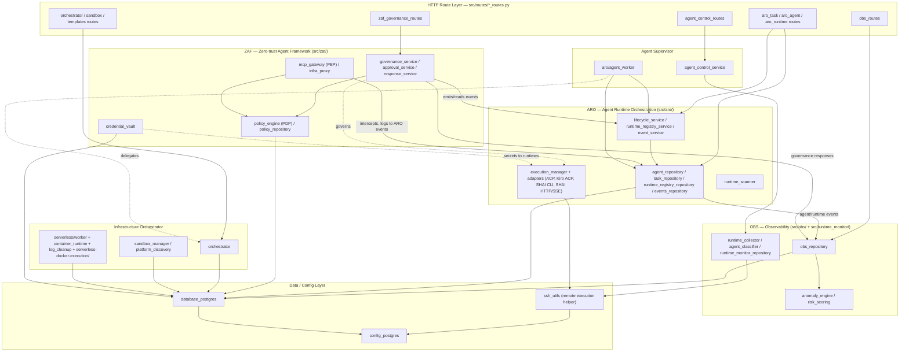

# 01 — Architecture Diagram

- **Title:** Architecture Diagram
- **Audit date:** 2026-10-31
- **Requirement coverage:** R1.1, R1.2, R1.3, R11.1
- **Method:** The five subsystem groupings were established from the `src/` directory layout (inspected live) and populated with the modules the design assigns to each. Principal runtime relationships are drawn from the cross-subsystem edge set observed by static import analysis in `docs/audit/02-dependency-map.md` (task 1) — this artifact renders those module-to-module edges at subsystem granularity rather than re-deriving them. A short prose legend follows the diagram.
- **Input:** `docs/audit/02-dependency-map.md` (task 1) — "Cross-Subsystem Edges (handoff to stage 01)" section and the full edge set.

## Inspected Sources

The `src/` layout was inspected and its modules grouped into the five subsystems below. Every module named here is recorded as inspected for the purposes of R11.1 (the exhaustive per-module inspection record lives in `02-dependency-map.md`, which covers all 94 `*.py` files under `src/`).

### Subsystem groupings (as inspected)

| Subsystem | Modules grouped under it |
|-----------|--------------------------|
| **ARO** — `src/aro/` | `agent_repository.py`, `agent_worker.py`, `lifecycle.py`, `lifecycle_service.py`, `execution_manager.py`, `task_repository.py`, `runtime_registry_repository.py`, `runtime_registry_service.py`, `runtime_scanner.py`, `event_service.py`, `events_repository.py`, `adapters/` (`base.py`, `acp_protocol.py`, `kiro_acp.py`, `shai_cli.py`, `shai_http_sse.py`, `sse_parser.py`) |
| **ZAF** — `src/zaf/` | `mcp_gateway.py`, `policy_engine.py`, `policy_repository.py`, `approval_service.py`, `response_service.py`, `infra_proxy.py`, `governance_service.py`, `credential_vault.py`, `providers/` (`openstack.py`) |
| **OBS** — `src/obs/` + `src/runtime_monitor/` | `obs_repository.py`, `anomaly_engine.py`, `risk_scoring.py`; `runtime_monitor/runtime_collector.py`, `runtime_monitor/agent_classifier.py`, `runtime_monitor/runtime_monitor_repository.py` |
| **Infrastructure Orchestrator** | `orchestrator.py`, `agent_control_service.py`, `sandbox_manager.py`, `platform_discovery.py`, `serverless/` (`worker.py`, `container_runtime.py`, `log_cleanup.py`, `config.py`), `serverless-docker-execution/` |
| **Agent Supervisor** | `aro/agent_worker.py` plus the orchestration modules (`orchestrator.py`, `agent_control_service.py`) that carry role / task-decomposition / delegation / governance-inheritance behavior |

Two shared layers are drawn alongside the subsystems because every subsystem depends on them (they are not a sixth subsystem, they are the common foundation):

- **HTTP route layer** — `src/routes/*_routes.py` (the entry edge into each subsystem: `aro_*_routes.py` → ARO, `zaf_governance_routes.py` → ZAF, `obs_routes.py` → OBS, `orchestrator_routes.py`/`sandbox_routes.py` → Infrastructure Orchestrator, `agent_control_routes.py` → Agent Supervisor).
- **Data / config layer** — `database_postgres.py` (fan-in 33) and `config_postgres.py` (fan-in 20), the two dominant hubs every subsystem's repositories resolve down to.

## Architecture Diagram (Mermaid)

The flowchart has one subgraph per subsystem (ARO, ZAF, OBS, Infrastructure Orchestrator, Agent Supervisor), plus the shared HTTP route layer and data/config layer. Edges follow the principal runtime relationships recorded in task 1: **routes → services → repositories → database**; **ZAF interception layered around ARO execution** (via the shared ARO event store); and **OBS consuming agent/runtime events**.

## Legend

- **Subgraphs** are the five audited subsystems plus the two shared layers (HTTP routes, data/config) they all rest on. Each subsystem subgraph collapses several modules into a few role-labeled nodes; the full module membership is in the "Subsystem groupings" table above and the exhaustive edge list is in `02-dependency-map.md`.
- **Solid arrows** (`-->`) are direct import/call relationships observed in task 1 (e.g. `aro_*_routes.py → aro/*`, `obs_routes.py → obs_repository.py`, every repository → `database_postgres.py`).
- **Dashed arrows** (`-. label .->`) mark runtime relationships that are real but not expressed as a static Python import in the current tree — notably ZAF *governing* ARO execution, the Supervisor *delegating* to the orchestrator, and the credential vault *passing secrets to runtimes*. Task 1 flagged the four ZAF enforcement components (`mcp_gateway`, `infra_proxy`, `response_service`, `credential_vault`) as having no inbound `src/` import, so these governance/enforcement edges are the intended runtime path rather than a wired import; they are candidates for `PARTIALLY_INTEGRATED` in the Gap Matrix (task 10).
- **Principal flows named by the diagram:**
  1. **Request path:** `routes → services → repositories → database` — the dominant pattern across ARO, ZAF, OBS, and Infrastructure Orchestrator, all terminating at `database_postgres.py`.
  2. **ZAF interception around ARO execution:** every ZAF service reads/writes the shared ARO event store (`aro/event_service.py` + `aro/events_repository.py`), so governance and interception are layered on top of ARO's execution events; ZAF additionally governs the ARO execution manager/adapters path.
  3. **OBS consuming events:** agent/runtime events written by ARO and governance responses from ZAF (`zaf/response_service.py → obs/obs_repository.py`) feed the observability store, which the anomaly engine consumes.
- **Shared foundation:** `database_postgres.py` (fan-in 33) and `config_postgres.py` (fan-in 20) are the two hubs every subsystem depends on; `ssh_utils.py` is the shared remote-execution helper used by the ARO execution path and the OBS runtime collector.

All five subsystems — **ARO, ZAF, OBS, Infrastructure Orchestrator, and Agent Supervisor** — are represented in the Mermaid block above, along with the relationships between them (ZAF↔ARO via the event store, ARO/ZAF→OBS via events, Supervisor→ARO and →orchestrator, and every subsystem→data/config layer), satisfying R1.3.
