# 02 — Module Dependency Map

- **Title:** Module Dependency Map
- **Audit date:** 2026-10-31
- **Requirement coverage:** R2.1, R2.2, R2.3, R11.1
- **Method:** Static import analysis. Every `*.py` under `src/` was parsed for `import` and `from … import` statements (seed grep `^\s*(import|from)\s+` within `src/`). Targets were filtered to known `src/` module names; a directed edge `A → B` is recorded when module A imports module B. Intra-`src/` edges only — external packages (`flask`, `psycopg2`, `requests`, `werkzeug`, stdlib, …) are excluded. Both top-level and function-local (lazy) imports are included, as are relative (`from .x`, `from ..x`) and absolute (`from src.x`) forms. This edge set feeds stages 01 (architecture diagram) and 08 (duplication / dead-module detection).
- **Edge total:** 211 intra-`src/` directed edges across 94 inspected modules.

## Inspected Sources

Every `*.py` under `src/` was inspected (94 files). All are listed below and each is recorded as inspected for the purposes of R11.1.

### `src/` top level
- `ControlPlanFlaskApp_postgres.py`
- `__init__.py`
- `agent_control_service.py`
- `auth.py`
- `authz.py`
- `config_postgres.py`
- `configuration_writer.py`
- `create_gitea_repo.py`
- `database_postgres.py`
- `db_health.py`
- `db_sync.py`
- `email_service.py`
- `frontend_manager.py`
- `frontend_nginx_manager.py`
- `gitea_config.py`
- `main.py`
- `mcp_interface.py`
- `orchestrator.py`
- `platform_discovery.py`
- `query_converter.py`
- `replication_manager.py`
- `sandbox_manager.py`
- `ssh_utils.py`
- `template_catalog.py`
- `template_deploy.py`

### `src/aro/`
- `aro/__init__.py`
- `aro/agent_repository.py`
- `aro/agent_worker.py`
- `aro/event_service.py`
- `aro/events_repository.py`
- `aro/execution_manager.py`
- `aro/lifecycle.py`
- `aro/lifecycle_service.py`
- `aro/runtime_registry_repository.py`
- `aro/runtime_registry_service.py`
- `aro/runtime_scanner.py`
- `aro/task_repository.py`

### `src/aro/adapters/`
- `aro/adapters/__init__.py`
- `aro/adapters/acp_protocol.py`
- `aro/adapters/base.py`
- `aro/adapters/kiro_acp.py`
- `aro/adapters/shai_cli.py`
- `aro/adapters/shai_http_sse.py`
- `aro/adapters/sse_parser.py`

### `src/zaf/`
- `zaf/__init__.py`
- `zaf/approval_service.py`
- `zaf/credential_vault.py`
- `zaf/governance_service.py`
- `zaf/infra_proxy.py`
- `zaf/mcp_gateway.py`
- `zaf/policy_engine.py`
- `zaf/policy_repository.py`
- `zaf/response_service.py`

### `src/zaf/providers/`
- `zaf/providers/__init__.py`
- `zaf/providers/openstack.py`

### `src/obs/`
- `obs/__init__.py`
- `obs/anomaly_engine.py`
- `obs/obs_repository.py`
- `obs/risk_scoring.py`

### `src/serverless/`
- `serverless/__init__.py`
- `serverless/config.py`
- `serverless/container_runtime.py`
- `serverless/log_cleanup.py`
- `serverless/worker.py`

### `src/runtime_monitor/`
- `runtime_monitor/__init__.py`
- `runtime_monitor/agent_classifier.py`
- `runtime_monitor/runtime_collector.py`
- `runtime_monitor/runtime_monitor_repository.py`

### `src/routes/`
- `routes/__init__.py`
- `routes/agent_control_routes.py`
- `routes/api_routes.py`
- `routes/aro_agent_routes.py`
- `routes/aro_common.py`
- `routes/aro_runtime_routes.py`
- `routes/aro_task_routes.py`
- `routes/auth_routes.py`
- `routes/billing_routes.py`
- `routes/engine_runner.py`
- `routes/genai_routes.py`
- `routes/gpu_routes.py`
- `routes/main_routes.py`
- `routes/obs_routes.py`
- `routes/orchestrator_routes.py`
- `routes/replication_routes.py`
- `routes/sandbox_routes.py`
- `routes/security_routes.py`
- `routes/serverless_routes.py`
- `routes/sso_routes.py`
- `routes/templates_routes.py`
- `routes/wizard_routes.py`
- `routes/zaf_governance_routes.py`

### `src/wizard/`
- `wizard/__init__.py`
- `wizard/setup_wizard.py`
- `wizard/ssl_configurator.py`

> **Extraction note (R-ambiguity handling).** `routes/api_routes.py` begins with a UTF-8 BOM (`U+FEFF`) that defeats a strict AST parse. Its intra-`src/` imports were recovered by direct grep instead and are included in all edge counts below: `config_postgres`, `database_postgres`, `replication_manager`, `db_health`, `frontend_manager`, `platform_discovery`, and `routes/billing_routes`. No other file failed to parse.

## Dependency Graph (Mermaid)

The graph below shows every module-to-module edge (`A → B` = A imports B), intra-`src/` only. Node labels use the module path relative to `src/`. The five subsystem groupings are annotated in the adjacency list that follows; the graph itself is a flat `graph LR` of the raw edge set as required by R2.2.

```mermaid
graph LR
    %% ---- Entry points / app assembly ----
    main["main.py"] --> ControlPlan["ControlPlanFlaskApp_postgres.py"]
    main --> database["database_postgres.py"]

    ControlPlan --> config["config_postgres.py"]
    ControlPlan --> database
    ControlPlan --> orchestrator["orchestrator.py"]
    ControlPlan --> replication["replication_manager.py"]
    ControlPlan --> r_agentctl["routes/agent_control_routes.py"]
    ControlPlan --> r_api["routes/api_routes.py"]
    ControlPlan --> r_aroagent["routes/aro_agent_routes.py"]
    ControlPlan --> r_aroruntime["routes/aro_runtime_routes.py"]
    ControlPlan --> r_arotask["routes/aro_task_routes.py"]
    ControlPlan --> r_auth["routes/auth_routes.py"]
    ControlPlan --> r_billing["routes/billing_routes.py"]
    ControlPlan --> r_genai["routes/genai_routes.py"]
    ControlPlan --> r_gpu["routes/gpu_routes.py"]
    ControlPlan --> r_main["routes/main_routes.py"]
    ControlPlan --> r_obs["routes/obs_routes.py"]
    ControlPlan --> r_orch["routes/orchestrator_routes.py"]
    ControlPlan --> r_repl["routes/replication_routes.py"]
    ControlPlan --> r_sandbox["routes/sandbox_routes.py"]
    ControlPlan --> r_security["routes/security_routes.py"]
    ControlPlan --> r_serverless["routes/serverless_routes.py"]
    ControlPlan --> r_sso["routes/sso_routes.py"]
    ControlPlan --> r_templates["routes/templates_routes.py"]
    ControlPlan --> r_wizard["routes/wizard_routes.py"]
    ControlPlan --> r_zaf["routes/zaf_governance_routes.py"]

    %% ---- Core data / config layer ----
    database --> config
    database --> query["query_converter.py"]
    database --> replication

    ssh["ssh_utils.py"] --> config
    frontend["frontend_manager.py"] --> config
    frontendnginx["frontend_nginx_manager.py"] --> config

    %% ---- Routes -> services / data ----
    r_agentctl --> init["__init__.py"]
    r_agentctl --> agentctl["agent_control_service.py"]
    r_agentctl --> config
    r_agentctl --> database
    r_agentctl --> rm_init["runtime_monitor/__init__.py"]
    r_agentctl --> rm_classifier["runtime_monitor/agent_classifier.py"]
    r_agentctl --> rm_collector["runtime_monitor/runtime_collector.py"]
    r_agentctl --> rm_repo["runtime_monitor/runtime_monitor_repository.py"]

    r_api --> config
    r_api --> database
    r_api --> replication
    r_api --> db_health["db_health.py"]
    r_api --> frontend
    r_api --> platdisc["platform_discovery.py"]
    r_api --> r_billing

    r_aroagent --> aro_init["aro/__init__.py"]
    r_aroagent --> aro_agentrepo["aro/agent_repository.py"]
    r_aroagent --> aro_lifesvc["aro/lifecycle_service.py"]
    r_aroagent --> aro_rtregrepo["aro/runtime_registry_repository.py"]
    r_aroagent --> authz["authz.py"]
    r_aroagent --> aro_common["routes/aro_common.py"]

    r_aroruntime --> aro_init
    r_aroruntime --> aro_rtregrepo
    r_aroruntime --> aro_rtregsvc["aro/runtime_registry_service.py"]
    r_aroruntime --> authz
    r_aroruntime --> aro_common

    r_arotask --> aro_init
    r_arotask --> aro_agentrepo
    r_arotask --> aro_eventsrepo["aro/events_repository.py"]
    r_arotask --> aro_taskrepo["aro/task_repository.py"]
    r_arotask --> authz
    r_arotask --> aro_common

    r_auth --> auth["auth.py"]
    r_auth --> config
    r_auth --> database
    r_auth --> replication

    r_billing --> config
    r_billing --> database

    r_genai --> config
    r_genai --> database
    r_genai --> r_billing

    r_gpu --> database
    r_gpu --> ssh

    r_main --> config
    r_main --> database

    r_obs --> aro_init
    r_obs --> aro_eventsrepo
    r_obs --> authz
    r_obs --> obs_init["obs/__init__.py"]
    r_obs --> obs_repo["obs/obs_repository.py"]

    r_orch --> init
    r_orch --> config
    r_orch --> database
    r_orch --> orchestrator
    r_orch --> r_billing

    r_repl --> replication

    r_sandbox --> config
    r_sandbox --> orchestrator
    r_sandbox --> sandbox["sandbox_manager.py"]

    r_security --> auth
    r_security --> config
    r_security --> database
    r_security --> email["email_service.py"]

    r_serverless --> database
    r_serverless --> sl_config["serverless/config.py"]

    r_sso --> auth
    r_sso --> config
    r_sso --> database

    r_templates --> config
    r_templates --> orchestrator
    r_templates --> tcat["template_catalog.py"]
    r_templates --> tdeploy["template_deploy.py"]

    r_wizard --> config
    r_wizard --> confwriter["configuration_writer.py"]
    r_wizard --> wizard_init["wizard/__init__.py"]

    r_engine["routes/engine_runner.py"] --> config

    r_zaf --> authz
    r_zaf --> aro_common
    r_zaf --> zaf_init["zaf/__init__.py"]
    r_zaf --> zaf_approval["zaf/approval_service.py"]
    r_zaf --> zaf_gov["zaf/governance_service.py"]
    r_zaf --> zaf_polrepo["zaf/policy_repository.py"]

    %% ---- ARO internals ----
    aro_agentrepo --> database
    aro_eventsrepo --> database
    aro_execmgr["aro/execution_manager.py"] --> database
    aro_execmgr --> ssh
    aro_rtregrepo --> database
    aro_taskrepo --> database

    aro_worker["aro/agent_worker.py"] --> aro_init
    aro_worker --> aro_eventsvc["aro/event_service.py"]
    aro_worker --> aro_eventsrepo
    aro_worker --> aro_taskrepo

    aro_lifesvc --> aro_init
    aro_lifesvc --> aro_agentrepo
    aro_lifesvc --> aro_eventsvc
    aro_lifesvc --> aro_eventsrepo
    aro_lifesvc --> aro_life["aro/lifecycle.py"]

    aro_scanner["aro/runtime_scanner.py"] --> aro_init
    aro_scanner --> aro_eventsvc

    %% ---- ARO adapters ----
    ad_kiro["aro/adapters/kiro_acp.py"] --> ad_init["aro/adapters/__init__.py"]
    ad_kiro --> ad_acp["aro/adapters/acp_protocol.py"]
    ad_kiro --> ad_base["aro/adapters/base.py"]
    ad_kiro --> ssh
    ad_shaicli["aro/adapters/shai_cli.py"] --> ad_base
    ad_shaicli --> ssh
    ad_shaihttp["aro/adapters/shai_http_sse.py"] --> ad_base
    ad_shaihttp --> ad_sse["aro/adapters/sse_parser.py"]

    %% ---- ZAF internals ----
    zaf_approval --> aro_init
    zaf_approval --> aro_eventsvc
    zaf_approval --> aro_eventsrepo
    zaf_approval --> database
    zaf_approval --> zaf_init
    zaf_approval --> zaf_gov

    zaf_credvault["zaf/credential_vault.py"] --> database

    zaf_gov --> aro_init
    zaf_gov --> aro_eventsvc
    zaf_gov --> aro_eventsrepo
    zaf_gov --> zaf_init
    zaf_gov --> zaf_polengine["zaf/policy_engine.py"]
    zaf_gov --> zaf_polrepo

    zaf_infra["zaf/infra_proxy.py"] --> aro_init
    zaf_infra --> aro_eventsvc
    zaf_infra --> aro_eventsrepo
    zaf_infra --> zaf_init
    zaf_infra --> zaf_gov
    zaf_infra --> zaf_polengine
    zaf_infra --> zaf_prov_init["zaf/providers/__init__.py"]
    zaf_infra --> zaf_openstack["zaf/providers/openstack.py"]

    zaf_gateway["zaf/mcp_gateway.py"] --> aro_init
    zaf_gateway --> aro_eventsvc
    zaf_gateway --> aro_eventsrepo
    zaf_gateway --> zaf_init
    zaf_gateway --> zaf_gov
    zaf_gateway --> zaf_polengine

    zaf_polrepo --> database

    zaf_response["zaf/response_service.py"] --> aro_init
    zaf_response --> aro_eventsvc
    zaf_response --> aro_eventsrepo
    zaf_response --> obs_init
    zaf_response --> obs_repo

    %% ---- OBS internals ----
    obs_anomaly["obs/anomaly_engine.py"] --> obs_init
    obs_anomaly --> obs_risk["obs/risk_scoring.py"]
    obs_repo --> database

    %% ---- OBS / runtime_monitor data ----
    rm_collector --> ssh
    rm_repo --> database

    %% ---- Infra orchestration / serverless ----
    orchestrator --> database
    sandbox --> init
    sandbox --> database
    sandbox --> frontend
    sandbox --> tcat
    sandbox --> tdeploy

    sl_worker["serverless/worker.py"] --> database
    sl_worker --> sl_config
    sl_worker --> sl_container["serverless/container_runtime.py"]
    sl_worker --> sl_cleanup["serverless/log_cleanup.py"]

    %% ---- misc leaves ----
    auth --> database
    authz --> database
    confwriter --> database
    db_health --> database
    tcat --> database
    tdeploy --> init
    tdeploy --> database
    tdeploy --> frontend
    mcp["mcp_interface.py"] --> init
    mcp --> agentctl
    mcp --> config
    mcp --> database
    mcp --> orchestrator
    mcp --> r_billing
    mcp --> r_engine
    mcp --> r_genai
    mcp --> rm_init
    mcp --> rm_classifier
    mcp --> rm_collector
    mcp --> rm_repo
    mcp --> tcat
    mcp --> tdeploy
    gitea_repo["create_gitea_repo.py"] --> gitea_config["gitea_config.py"]
    wizard_init --> wiz_setup["wizard/setup_wizard.py"]
    wizard_init --> wiz_ssl["wizard/ssl_configurator.py"]
```

## Per-Module Adjacency List

For each module: the intra-`src/` modules it depends on (imports). Modules whose dependency set is empty (external-only imports) are listed under "Leaf modules" at the end. Grouped by subsystem for readability.

### App assembly / entry points

| Module | Depends on (imports) |
|--------|----------------------|
| `main.py` | `ControlPlanFlaskApp_postgres.py`, `database_postgres.py` |
| `ControlPlanFlaskApp_postgres.py` | `config_postgres.py`, `database_postgres.py`, `orchestrator.py`, `replication_manager.py`, `routes/agent_control_routes.py`, `routes/api_routes.py`, `routes/aro_agent_routes.py`, `routes/aro_runtime_routes.py`, `routes/aro_task_routes.py`, `routes/auth_routes.py`, `routes/billing_routes.py`, `routes/genai_routes.py`, `routes/gpu_routes.py`, `routes/main_routes.py`, `routes/obs_routes.py`, `routes/orchestrator_routes.py`, `routes/replication_routes.py`, `routes/sandbox_routes.py`, `routes/security_routes.py`, `routes/serverless_routes.py`, `routes/sso_routes.py`, `routes/templates_routes.py`, `routes/wizard_routes.py`, `routes/zaf_governance_routes.py` |
| `mcp_interface.py` | `__init__.py`, `agent_control_service.py`, `config_postgres.py`, `database_postgres.py`, `orchestrator.py`, `routes/billing_routes.py`, `routes/engine_runner.py`, `routes/genai_routes.py`, `runtime_monitor/__init__.py`, `runtime_monitor/agent_classifier.py`, `runtime_monitor/runtime_collector.py`, `runtime_monitor/runtime_monitor_repository.py`, `template_catalog.py`, `template_deploy.py` |

### Core data / config layer

| Module | Depends on (imports) |
|--------|----------------------|
| `database_postgres.py` | `config_postgres.py`, `query_converter.py`, `replication_manager.py` |
| `ssh_utils.py` | `config_postgres.py` |
| `frontend_manager.py` | `config_postgres.py` |
| `frontend_nginx_manager.py` | `config_postgres.py` |
| `db_health.py` | `database_postgres.py` |
| `configuration_writer.py` | `database_postgres.py` |
| `auth.py` | `database_postgres.py` |
| `authz.py` | `database_postgres.py` |
| `template_catalog.py` | `database_postgres.py` |
| `template_deploy.py` | `__init__.py`, `database_postgres.py`, `frontend_manager.py` |

### Routes (`src/routes/`)

| Module | Depends on (imports) |
|--------|----------------------|
| `routes/agent_control_routes.py` | `__init__.py`, `agent_control_service.py`, `config_postgres.py`, `database_postgres.py`, `runtime_monitor/__init__.py`, `runtime_monitor/agent_classifier.py`, `runtime_monitor/runtime_collector.py`, `runtime_monitor/runtime_monitor_repository.py` |
| `routes/api_routes.py` | `config_postgres.py`, `database_postgres.py`, `replication_manager.py`, `db_health.py`, `frontend_manager.py`, `platform_discovery.py`, `routes/billing_routes.py` |
| `routes/aro_agent_routes.py` | `aro/__init__.py`, `aro/agent_repository.py`, `aro/lifecycle_service.py`, `aro/runtime_registry_repository.py`, `authz.py`, `routes/aro_common.py` |
| `routes/aro_runtime_routes.py` | `aro/__init__.py`, `aro/runtime_registry_repository.py`, `aro/runtime_registry_service.py`, `authz.py`, `routes/aro_common.py` |
| `routes/aro_task_routes.py` | `aro/__init__.py`, `aro/agent_repository.py`, `aro/events_repository.py`, `aro/task_repository.py`, `authz.py`, `routes/aro_common.py` |
| `routes/auth_routes.py` | `auth.py`, `config_postgres.py`, `database_postgres.py`, `replication_manager.py` |
| `routes/billing_routes.py` | `config_postgres.py`, `database_postgres.py` |
| `routes/engine_runner.py` | `config_postgres.py` |
| `routes/genai_routes.py` | `config_postgres.py`, `database_postgres.py`, `routes/billing_routes.py` |
| `routes/gpu_routes.py` | `database_postgres.py`, `ssh_utils.py` |
| `routes/main_routes.py` | `config_postgres.py`, `database_postgres.py` |
| `routes/obs_routes.py` | `aro/__init__.py`, `aro/events_repository.py`, `authz.py`, `obs/__init__.py`, `obs/obs_repository.py` |
| `routes/orchestrator_routes.py` | `__init__.py`, `config_postgres.py`, `database_postgres.py`, `orchestrator.py`, `routes/billing_routes.py` |
| `routes/replication_routes.py` | `replication_manager.py` |
| `routes/sandbox_routes.py` | `config_postgres.py`, `orchestrator.py`, `sandbox_manager.py` |
| `routes/security_routes.py` | `auth.py`, `config_postgres.py`, `database_postgres.py`, `email_service.py` |
| `routes/serverless_routes.py` | `database_postgres.py`, `serverless/config.py` |
| `routes/sso_routes.py` | `auth.py`, `config_postgres.py`, `database_postgres.py` |
| `routes/templates_routes.py` | `config_postgres.py`, `orchestrator.py`, `template_catalog.py`, `template_deploy.py` |
| `routes/wizard_routes.py` | `config_postgres.py`, `configuration_writer.py`, `wizard/__init__.py` |
| `routes/zaf_governance_routes.py` | `authz.py`, `routes/aro_common.py`, `zaf/__init__.py`, `zaf/approval_service.py`, `zaf/governance_service.py`, `zaf/policy_repository.py` |
| `routes/aro_common.py` | `config_postgres.py` |

### ARO (`src/aro/`)

| Module | Depends on (imports) |
|--------|----------------------|
| `aro/agent_repository.py` | `database_postgres.py` |
| `aro/events_repository.py` | `database_postgres.py` |
| `aro/execution_manager.py` | `database_postgres.py`, `ssh_utils.py` |
| `aro/runtime_registry_repository.py` | `database_postgres.py` |
| `aro/task_repository.py` | `database_postgres.py` |
| `aro/agent_worker.py` | `aro/__init__.py`, `aro/event_service.py`, `aro/events_repository.py`, `aro/task_repository.py` |
| `aro/lifecycle_service.py` | `aro/__init__.py`, `aro/agent_repository.py`, `aro/event_service.py`, `aro/events_repository.py`, `aro/lifecycle.py` |
| `aro/runtime_scanner.py` | `aro/__init__.py`, `aro/event_service.py` |
| `aro/adapters/kiro_acp.py` | `aro/adapters/__init__.py`, `aro/adapters/acp_protocol.py`, `aro/adapters/base.py`, `ssh_utils.py` |
| `aro/adapters/shai_cli.py` | `aro/adapters/base.py`, `ssh_utils.py` |
| `aro/adapters/shai_http_sse.py` | `aro/adapters/base.py`, `aro/adapters/sse_parser.py` |

### ZAF (`src/zaf/`)

| Module | Depends on (imports) |
|--------|----------------------|
| `zaf/approval_service.py` | `aro/__init__.py`, `aro/event_service.py`, `aro/events_repository.py`, `database_postgres.py`, `zaf/__init__.py`, `zaf/governance_service.py` |
| `zaf/credential_vault.py` | `database_postgres.py` |
| `zaf/governance_service.py` | `aro/__init__.py`, `aro/event_service.py`, `aro/events_repository.py`, `zaf/__init__.py`, `zaf/policy_engine.py`, `zaf/policy_repository.py` |
| `zaf/infra_proxy.py` | `aro/__init__.py`, `aro/event_service.py`, `aro/events_repository.py`, `zaf/__init__.py`, `zaf/governance_service.py`, `zaf/policy_engine.py`, `zaf/providers/__init__.py`, `zaf/providers/openstack.py` |
| `zaf/mcp_gateway.py` | `aro/__init__.py`, `aro/event_service.py`, `aro/events_repository.py`, `zaf/__init__.py`, `zaf/governance_service.py`, `zaf/policy_engine.py` |
| `zaf/policy_repository.py` | `database_postgres.py` |
| `zaf/response_service.py` | `aro/__init__.py`, `aro/event_service.py`, `aro/events_repository.py`, `obs/__init__.py`, `obs/obs_repository.py` |

### OBS (`src/obs/`)

| Module | Depends on (imports) |
|--------|----------------------|
| `obs/anomaly_engine.py` | `obs/__init__.py`, `obs/risk_scoring.py` |
| `obs/obs_repository.py` | `database_postgres.py` |

### Infrastructure Orchestrator / serverless

| Module | Depends on (imports) |
|--------|----------------------|
| `orchestrator.py` | `database_postgres.py` |
| `sandbox_manager.py` | `__init__.py`, `database_postgres.py`, `frontend_manager.py`, `template_catalog.py`, `template_deploy.py` |
| `serverless/worker.py` | `database_postgres.py`, `serverless/config.py`, `serverless/container_runtime.py`, `serverless/log_cleanup.py` |

### Runtime monitor

| Module | Depends on (imports) |
|--------|----------------------|
| `runtime_monitor/runtime_collector.py` | `ssh_utils.py` |
| `runtime_monitor/runtime_monitor_repository.py` | `database_postgres.py` |

### Misc

| Module | Depends on (imports) |
|--------|----------------------|
| `create_gitea_repo.py` | `gitea_config.py` |
| `wizard/__init__.py` | `wizard/setup_wizard.py`, `wizard/ssl_configurator.py` |

### Leaf modules (no intra-`src/` dependencies — external-only imports)

`__init__.py`, `agent_control_service.py`, `config_postgres.py`, `db_sync.py`, `email_service.py`, `gitea_config.py`, `platform_discovery.py`, `query_converter.py`, `replication_manager.py`, `aro/__init__.py`, `aro/event_service.py`, `aro/lifecycle.py`, `aro/runtime_registry_service.py`, `aro/adapters/__init__.py`, `aro/adapters/acp_protocol.py`, `aro/adapters/base.py`, `aro/adapters/sse_parser.py`, `zaf/__init__.py`, `zaf/policy_engine.py`, `zaf/providers/__init__.py`, `zaf/providers/openstack.py`, `obs/__init__.py`, `obs/risk_scoring.py`, `serverless/__init__.py`, `serverless/config.py`, `serverless/container_runtime.py`, `serverless/log_cleanup.py`, `runtime_monitor/__init__.py`, `runtime_monitor/agent_classifier.py`, `routes/__init__.py`, `wizard/setup_wizard.py`, `wizard/ssl_configurator.py`, `gitea_config.py`.

> Note: `aro/runtime_registry_service.py` and `aro/lifecycle.py` import no other `src/` module (they are imported by, but do not import, siblings). `config_postgres.py` imports only stdlib/external — it is the terminal sink of the config layer.

## High Fan-In Modules (most depended-upon)

Fan-in = number of distinct `src/` modules that import the module. High fan-in marks a hub whose change impact is broad; these are the modules stages 01 and 08 must treat as central.

| Fan-in | Module | Role |
|--------|--------|------|
| 33 | `database_postgres.py` | Central data-access layer. Almost every repository, route, and service imports it. The single largest change-impact surface in the codebase. |
| 20 | `config_postgres.py` | Global configuration/constants (domain, secrets, translations, SSH helpers). Imported by the app, routes, and infra helpers. |
| 12 | `aro/__init__.py` | ARO package init — imported by every ARO-internal module and by ZAF services and ARO routes (package-level re-exports). |
| 9 | `aro/events_repository.py` | Shared event store used across ARO, ZAF (governance/gateway/approval/infra/response), and OBS routes. |
| 8 | `aro/event_service.py` | Event-emission service consumed by ARO workers/scanner/lifecycle and all ZAF services. |
| 5 | `ssh_utils.py` | Remote-execution helper used by ARO adapters, execution manager, runtime collector, gpu routes. |
| 5 | `orchestrator.py` | Infrastructure orchestrator, imported by the app, mcp_interface, and sandbox/templates/orchestrator routes. |
| 5 | `replication_manager.py` | Cross-server replication, imported (mostly lazily) by `database_postgres`, the app, api/auth/replication routes. |
| 5 | `zaf/__init__.py` | ZAF package init re-exported across ZAF services and ZAF routes. |
| 5 | `authz.py` | Tenant-scoping / authorization decorator, imported by all ARO routes, OBS routes, and ZAF routes. |
| 5 | `__init__.py` (`src/__init__.py`) | Top-level package init imported by mcp_interface, sandbox_manager, template_deploy, agent_control/orchestrator routes. |
| 4 | `routes/aro_common.py` | Shared ARO route helpers (imported by all four ARO/ZAF route modules). |
| 4 | `zaf/governance_service.py` | ZAF governance hub — imported by gateway, infra_proxy, approval, and ZAF routes. |
| 4 | `routes/billing_routes.py` | Billing helpers re-used by api/genai/orchestrator routes and mcp_interface. |

`database_postgres.py` and `config_postgres.py` are confirmed as the two dominant high-fan-in hubs called out by the task; a change to either ripples across essentially the whole tree.

## High Fan-Out Modules (most dependent)

Fan-out = number of distinct `src/` modules the module imports. High fan-out marks an orchestration/wiring point.

| Fan-out | Module | Role |
|--------|--------|------|
| 24 | `ControlPlanFlaskApp_postgres.py` | Flask app factory — registers every route blueprint plus core services. |
| 14 | `mcp_interface.py` | MCP tool surface that reaches into config, DB, orchestrator, runtime monitor, templates, and several route helpers. |
| 8 | `routes/agent_control_routes.py` | Agent-control route wiring over the runtime_monitor stack. |
| 8 | `zaf/infra_proxy.py` | ZAF infra interception pulling in governance, policy, ARO events, and OpenStack provider. |
| 6 | `zaf/mcp_gateway.py`, `zaf/governance_service.py`, `zaf/approval_service.py`, `routes/zaf_governance_routes.py`, `routes/aro_agent_routes.py`, `routes/aro_task_routes.py` | ZAF/ARO service and route wiring points. |

## Cycles

No import cycles were detected. Strongly-connected-component analysis (Tarjan) over the 211-edge graph found **no SCC of size > 1, no self-loops, and no mutual (A↔B) pairs**.

The two points that most often cause cycles in this style of codebase are deliberately broken with function-local (lazy) imports:

- `database_postgres.py → replication_manager.py` exists (lazy import inside `execute_query`), but `replication_manager.py` imports no `src/` module, so there is no back-edge.
- `ssh_utils.py → config_postgres.py` is a lazy import inside a helper; `config_postgres.py` is a leaf, so no cycle forms.
- ARO route modules and `sandbox_routes.py` import `orchestrator`/services lazily inside factory functions; none of those targets import back into the route layer.

The dependency graph is therefore a DAG.

## Dead / Entry-Point Modules (no inbound `src/` imports)

Modules with zero inbound intra-`src/` edges are either legitimate entry points/workers or candidate dead code. This list is handed to stage 08 for duplication/obsolescence classification; it is **not** a conclusion of deadness on its own (several are process entry points or are invoked via framework/CLI, not Python imports).

| Module | Likely nature |
|--------|---------------|
| `main.py` | Application entry point (WSGI/CLI). Expected to have no importers. |
| `mcp_interface.py` | MCP server entry surface; invoked by an external MCP host, not imported. |
| `db_sync.py` | Standalone sync script/CLI. |
| `db_health.py` | Imported by `routes/api_routes.py` — **not actually dead**; appears here only because the BOM parse failure was recovered by grep (edge confirmed, so treat as live). |
| `platform_discovery.py` | Imported by `routes/api_routes.py` (BOM-recovered) — **not dead**; live. |
| `create_gitea_repo.py` | Standalone provisioning script/CLI. |
| `frontend_nginx_manager.py` | Nginx variant manager; no importer found — candidate obsolete (note: platform now uses Traefik; cross-check with stage 08 against `frontend_manager.py`). |
| `serverless/worker.py` | Serverless worker process entry point. |
| `wizard/setup_wizard.py`, `wizard/ssl_configurator.py` | Imported via `wizard/__init__.py` re-export — **not dead**; reached through the package init. |
| `aro/agent_worker.py` | Background worker entry; invoked as a process, not imported by siblings. |
| `aro/execution_manager.py` | Candidate: no inbound import found in `src/` — cross-check whether it is wired via routes/services (feeds stage 08 and the Gap Matrix "Execution manager" row). |
| `aro/runtime_scanner.py` | Candidate: no inbound import — likely invoked as a scan task/worker. |
| `obs/anomaly_engine.py` | Candidate: no inbound import — OBS anomaly engine may not yet be wired into a route/worker (feeds stage 08 and the OBS Gap Matrix rows). |
| `zaf/mcp_gateway.py`, `zaf/infra_proxy.py`, `zaf/response_service.py`, `zaf/credential_vault.py` | ZAF enforcement/response components with no inbound `src/` import. Candidates for **PARTIALLY_INTEGRATED** in the Gap Matrix — the services exist but are not imported by any route/app module, suggesting the enforcement path may not be wired end-to-end. Hand to stages 05 and 09. |

> **Handoff note for stage 08.** The modules flagged "candidate" above (notably `aro/execution_manager.py`, `aro/runtime_scanner.py`, `obs/anomaly_engine.py`, and the four ZAF components `mcp_gateway.py`, `infra_proxy.py`, `response_service.py`, `credential_vault.py`) have no inbound imports in the current edge set. Stage 08 should determine whether each is (a) invoked via a non-import mechanism (worker/CLI/framework), (b) genuinely not-yet-integrated, or (c) obsolete. Entry points and `__init__`-reexported modules are explicitly excluded from the dead-code conclusion.

## Cross-Subsystem Edges (handoff to stage 01)

The principal cross-subsystem relationships observed, which stage 01 will render as subsystem-level edges:

- **Routes → ARO services/repositories:** `aro_*_routes.py` → `aro/*` (agent_repository, task_repository, events_repository, lifecycle_service, runtime_registry_*).
- **Routes → ZAF:** `zaf_governance_routes.py` → `zaf/*` (approval_service, governance_service, policy_repository).
- **Routes → OBS:** `obs_routes.py` → `obs/obs_repository.py` (and `aro/events_repository.py`).
- **ZAF → ARO:** every ZAF service (`governance_service`, `mcp_gateway`, `infra_proxy`, `approval_service`, `response_service`) imports `aro/event_service.py` + `aro/events_repository.py` — ZAF interception/governance is layered on the ARO event store.
- **ZAF → OBS:** `zaf/response_service.py` → `obs/obs_repository.py` — governance responses feed the observability store.
- **Everything → data/config layer:** `database_postgres.py` (fan-in 33) and `config_postgres.py` (fan-in 20) are the shared foundation every subsystem depends on.
- **ARO/Infra → remote execution:** `aro/execution_manager.py`, ARO adapters, `runtime_monitor/runtime_collector.py`, and `gpu_routes.py` all depend on `ssh_utils.py`.
